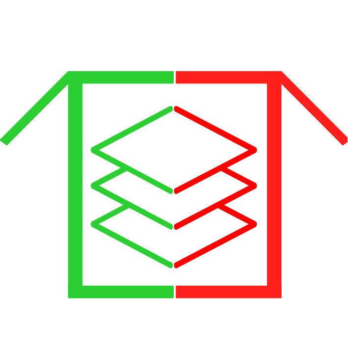
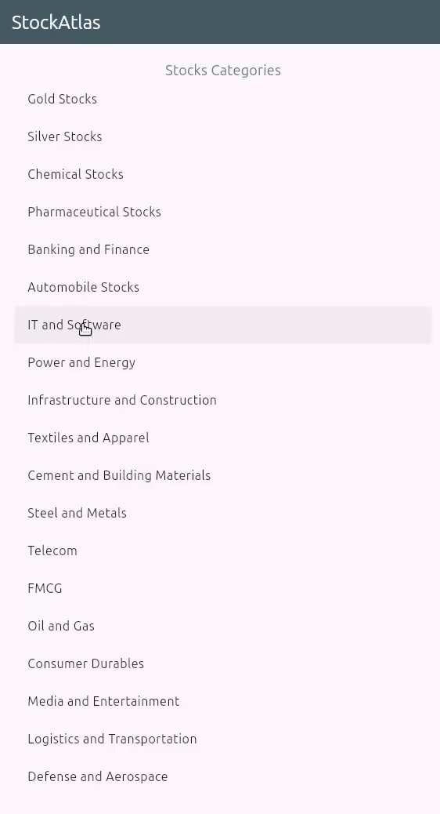

# 📊 StockAtlas

<div align="center">
  
  
  [](https://flutter.dev)
  [](https://dart.dev)
  [](https://pub.dev/packages/get)
  [](https://opensource.org/licenses/MIT)
  
  **A categorized view of NSE stocks with real-time price tracking**
  
  [Features](#-features) • [Installation](#️-installation) • [Usage](#-usage) • [Contributing](#-contributing)
</div>

---

## 📝 About

**StockAtlas** is a Flutter application that organizes and categorizes NSE (National Stock Exchange of India) stocks by sector or theme (e.g., IT, Banking, Chemicals, Gold). It provides a clean, grouped view of stocks with live price updates, making it easy to explore different industries at a glance.

### 🎯 Key Highlights

- **Sector-wise Organization**: Browse stocks grouped by industry sectors
- **Live Price Updates**: Real-time price fetching every 15 seconds during market hours (9:15 AM - 3:30 PM IST)
- **Smart Refresh**: Automatic pause when Indian markets are closed
- **Visual Indicators**: Color-coded price movements for quick insights
- **Cross-Platform**: Runs on Android, iOS, Linux, and Windows

---

## ✨ Features

### Current Features

- 📱 **Multi-Platform Support** - Android, iOS, Linux, and Windows
- 🏢 **Categorized Stock View** - Major NSE stocks organized by sectors
- 📈 **Real-Time Price Updates** - Live data fetching using Yahoo Finance
- 🎨 **Color-Coded Changes**
  - 🟢 **Green** → Price Increased
  - 🔴 **Red** → Price Decreased
  - ⚫ **Black** → Neutral/Loading
- ⏱️ **15-Second Auto-Refresh** - During market hours only
- 🔄 **GetX State Management** - Smooth and reactive UI updates
- 🇮🇳 **Indian Market Focus** - Optimized for NSE trading hours

### 🎬 Demo

<div align="center">
  
</div>

---

## 🛠️ Tech Stack

| Component | Technology |
|-----------|------------|
| **Framework** | Flutter 3.9.2+ |
| **Language** | Dart 3.9.2+ |
| **State Management** | GetX 4.7.2 |
| **Data Source** | Yahoo Finance Data Reader 1.0.12 |
| **Architecture** | MVC Pattern with Services |
| **UI Design** | Material Design |

---

## 📁 Project Structure
```
lib/
├── app.dart                           # App configuration and theme
├── commons.dart                       # Shared imports and utilities
├── main.dart                          # Application entry point
├── screens/
│   ├── home/
│   │   ├── home_controller.dart       # Home screen state management
│   │   └── home_screen.dart           # Stock categories listing
│   └── category/
│       ├── category_controller.dart   # Category data & refresh logic
│       └── category_screen.dart       # Stock list by category
└── services/
    └── stock_data_service.dart        # Yahoo Finance API integration

assets/
├── data/
│   └── stocks.json                    # Stock categorization data
└── images/
    └── app_logo.png                   # Application logo
```

---

## 🖥️ Supported Platforms

| Platform | Status | Tested |
|----------|--------|--------|
| Android | ✅ Supported | ✅ Yes |
| iOS | ✅ Supported | ⚠️ Not tested |
| Linux | ✅ Supported | ✅ Yes |
| Windows | ✅ Supported | ⚠️ Not tested |
| macOS | ⚠️ Should work | ❌ No |
| Web | ❌ Not optimized | ❌ No |

---

## ⚙️ Installation

### Prerequisites

Before you begin, ensure you have:
- [Flutter SDK](https://flutter.dev/docs/get-started/install) (3.9.2 or higher)
- [Dart SDK](https://dart.dev/get-dart) (3.9.2 or higher)
- Android Studio / Xcode (for mobile development)
- A code editor (VS Code, Android Studio, IntelliJ IDEA)

### Setup Steps

1. **Clone the repository**
```bash
   git clone https://github.com/hariraja-07/stockatlas.git
   cd stockatlas
```

2. **Install dependencies**
```bash
   flutter pub get
```

3. **Verify Flutter installation**
```bash
   flutter doctor
```

4. **Run the application**
```bash
   # For Android/iOS
   flutter run
   
   # For Linux
   flutter run -d linux
   
   # For Windows
   flutter run -d windows
```

---

## 📖 Usage

### Basic Navigation

1. **Launch the app** - You'll see the home screen with stock categories
2. **Select a category** - Tap on any sector (e.g., IT, Banking, Metals)
3. **View live prices** - Stocks in that category display with:
   - Current price
   - Daily change (₹)
   - Percentage change (%)
4. **Auto-refresh** - Prices update every 15 seconds during market hours

### Market Hours

The app automatically detects Indian market hours:
- **Trading Days**: Monday - Friday
- **Active Hours**: 9:15 AM - 3:30 PM IST
- **Status**: Auto-pause updates when markets are closed

---

## 🔧 Configuration

### Customizing Stock Data

Stock categories are defined in `assets/data/stocks.json`. To modify:

1. Open `assets/data/stocks.json`
2. Add/remove stock symbols following the existing structure
3. Run `flutter pub get` to rebuild assets
4. Restart the app

**Example structure:**
```json
{
  "IT": ["TCS", "INFY", "WIPRO"],
  "Banking": ["HDFCBANK", "ICICIBANK", "SBIN"]
}
```

### Changing Refresh Interval

To modify the refresh rate, edit `lib/screens/category/category_controller.dart`:
```dart
// Default: 15 seconds
Timer.periodic(Duration(seconds: 15), (timer) {
  // Update logic
});
```

---

## 🗺️ Roadmap

### Planned Features

- [ ] **Expanded Coverage**
  - Add more NSE stocks
  - Include BSE (Bombay Stock Exchange) stocks
- [ ] **Improved Categorization**
  - Refine sector classifications
  - Add sub-categories and filters
- [ ] **Performance Enhancements**
  - Faster price rendering
  - Optimized API calls
  - Data caching for offline viewing
- [ ] **Additional Features**
  - Stock search functionality
  - Favorites/Watchlist
  - Price alerts
  - Historical charts
  - Portfolio tracking
  - Dark mode support

### Future Considerations

- Multi-exchange support (international markets)
- News integration for stocks
- Technical indicators and analysis

---

## 🐛 Troubleshooting

### Common Issues

**Problem: Prices not updating**
- Verify internet connection
- Check if markets are open (Mon-Fri, 9:15 AM - 3:30 PM IST)
- Ensure Yahoo Finance API is accessible

**Problem: Build errors**
```bash
flutter clean
flutter pub get
flutter run
```

**Problem: GetX navigation not working**
- Ensure `GetMaterialApp` is used in `app.dart` instead of `MaterialApp`

**Problem: Asset not found errors**
```bash
flutter pub get
# Then restart the app
```

---

## 🤝 Contributing

Contributions are welcome! Here's how you can help:

### How to Contribute

1. **Fork the repository**
```bash
   git clone https://github.com/hariraja-07/stockatlas.git
```

2. **Create a feature branch**
```bash
   git checkout -b feature/your-feature-name
```

3. **Make your changes**
   - Follow existing code style
   - Add comments for complex logic
   - Test thoroughly on multiple platforms

4. **Commit with clear messages**
```bash
   git commit -m "feat: add stock search functionality"
```
   
   Use conventional commits:
   - `feat:` - New feature
   - `fix:` - Bug fix
   - `docs:` - Documentation changes
   - `refactor:` - Code refactoring
   - `test:` - Adding tests

5. **Push and create a Pull Request**
```bash
   git push origin feature/your-feature-name
```

### Code of Conduct

- Be respectful and inclusive
- Provide constructive feedback
- Focus on the code, not the person
- Help others learn and grow

---

## 📄 License

This project is licensed under the **MIT License** - see the [LICENSE](LICENSE) file for details.
```
MIT License

Copyright (c) 2025 Hariharasudhan Rajendiran

Permission is hereby granted, free of charge, to any person obtaining a copy
of this software and associated documentation files (the "Software"), to deal
in the Software without restriction, including without limitation the rights
to use, copy, modify, merge, publish, distribute, sublicense, and/or sell
copies of the Software, and to permit persons to whom the Software is
furnished to do so, subject to the following conditions:

The above copyright notice and this permission notice shall be included in all
copies or substantial portions of the Software.

THE SOFTWARE IS PROVIDED "AS IS", WITHOUT WARRANTY OF ANY KIND, EXPRESS OR
IMPLIED, INCLUDING BUT NOT LIMITED TO THE WARRANTIES OF MERCHANTABILITY,
FITNESS FOR A PARTICULAR PURPOSE AND NONINFRINGEMENT.
```

---

## 📬 Contact & Support

- **Developer**: Hariharasudhan Rajendiran
- **GitHub**: [@hariraja-07](https://github.com/hariraja-07)
- **Email**: hariraja1976@gmail.com
- **Issues**: [Report a Bug](https://github.com/hariraja-07/stockatlas/issues)
- **Discussions**: [GitHub Discussions](https://github.com/hariraja-07/stockatlas/discussions)

---

## 🙏 Acknowledgments

- [Yahoo Finance Data Reader](https://pub.dev/packages/yahoo_finance_data_reader) - For providing reliable stock market data
- [GetX](https://pub.dev/packages/get) - For excellent state management
- [Flutter Community](https://flutter.dev/community) - For continuous support and inspiration
- National Stock Exchange of India (NSE) - For market data

---

## 📊 Version History

| Version | Date | Changes |
|---------|------|---------|
| 1.1.0+3 | 2025 | Current release with stock price change coloring and percentage feature |
| 1.0.1+2 | 2025 | Added App Logo |
| 1.0.0+1 | 2025 | Initial release |

---

<div align="center">
  
**StockAtlas** - *Your gateway to organized stock market insights* 📈

Made with ❤️ by [Hariharasudhan Rajendiran](https://github.com/hariraja-07)

⭐ Star this repository if you find it helpful!

</div>